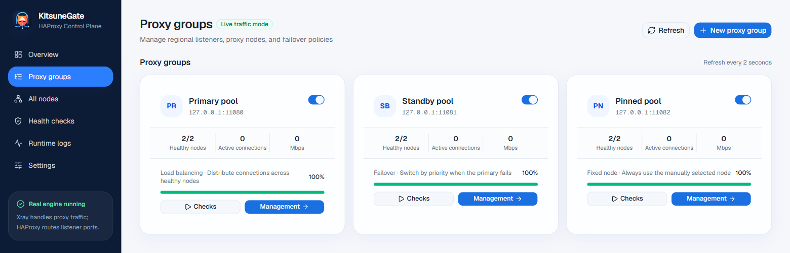

<p align="center">
  
</p>

<h1 align="center">KitsuneGate</h1>

KitsuneGate manages independent SOCKS5 proxy groups from a web dashboard. Each group has its own listener, outbound nodes and routing policy. If a configuration change fails in one group, an active download through another can finish on the same connection.



## How it works

On Linux, HAProxy accepts incoming TCP connections and Xray connects to the selected outbound. Add nodes from share links, manual settings or Xray outbound JSON. Supported protocols include VLESS, VMess, Shadowsocks, Trojan, Hysteria2 and SOCKS.

Each group runs HTTP or HTTPS checks through its nodes. Its routing policy determines where new connections go.

| Policy | Node selection |
| --- | --- |
| Load balancing | Shares connections among healthy nodes using weighted least connections, round robin or random selection. |
| Failover | Uses the healthy node with the lowest priority number. |
| Lowest latency | Prefers the fastest healthy node and switches when the improvement exceeds the configured tolerance. |
| Fixed node | Uses one node you choose. |

The dashboard shows active connections and traffic history per listener, along with health-check results and runtime logs.

## Run the published image

Use Docker Engine on Linux (AMD64 or ARM64). The image includes the dashboard, HAProxy and the outbound core. The v0.1.x images ship with sing-box. For Xray, choose a release that includes it or build this checkout from source.

### Docker Compose

In an empty directory, download the project's [Compose file](docker-compose.yml).

```bash
curl -fsSLO https://raw.githubusercontent.com/touka2014/kitsunegate/main/docker-compose.yml
```

Create a file named `.env` alongside it. Add `KITSUNEGATE_ADMIN_PASSWORD=` followed by a unique dashboard password. The default username is `kitsunegate`. Compose pulls `latest` by default. To pin a release, set `KITSUNEGATE_IMAGE` in the same file to its full image reference, such as `ghcr.io/touka2014/kitsunegate:0.1.1`.

```bash
docker compose pull
docker compose up -d --no-build
```

### Docker CLI

To start the same image with `docker run`, create the password file `.env` as described above and run the following command. Docker pulls the image if it is missing.

```bash
docker run -d --name kitsunegate --restart unless-stopped \
  --network host --env-file .env \
  -v "$PWD/deployment-data:/app/data" \
  ghcr.io/touka2014/kitsunegate:latest
```

### Connect a client

Open `http://<server-host>:8080` and sign in. Add an outbound node to a group and run a health check. Set your client's SOCKS5 proxy to the group's reachable address and listener port. Host networking makes each group port available directly on the Linux host.

Restrict the dashboard to administrators and the SOCKS5 ports to trusted clients. The dashboard password protects the management interface. Use HTTPS when accessing it over an untrusted network.

## Build from source

From a checkout with your dashboard password set in `.env`, build and start a local image with the repository's Compose file.

```bash
KITSUNEGATE_IMAGE=kitsunegate:local docker compose up -d --build
```

For local development, use Node.js 24 and run the following in the checkout. The core installer supports Windows x64 and Linux x64/arm64. On Linux it requires `unzip`.

```bash
npm ci
npm run core:install
npm run dev
```

Open `http://localhost:3000` and sign in as `kitsunegate`. The local API writes a generated password to `data/.admin-password` unless you supply `KITSUNEGATE_ADMIN_PASSWORD` in its environment.

## Data and upgrades

Both container examples store the database and its credential-encryption key in `./deployment-data`. Before upgrading, stop the container and back up that directory together with any custom `KITSUNEGATE_SECRET`. For a Compose installation, run the pull and start commands above from the same directory after selecting the image tag you want.

When moving from v0.1.x to Xray, allow a maintenance window for the first start. KitsuneGate validates existing nodes. If a node cannot be migrated, you can see the reason in its event history and edit its saved configuration.

Branch pushes build a test image for CI. Pushing a version tag such as `v0.2.0` triggers publication of the AMD64 and ARM64 images to GHCR and creates the GitHub Release. [Published releases](https://github.com/touka2014/kitsunegate/releases) · [Release workflow](.github/workflows/container.yml)

## License

KitsuneGate is an independent project distributed under the [MIT License](LICENSE).
